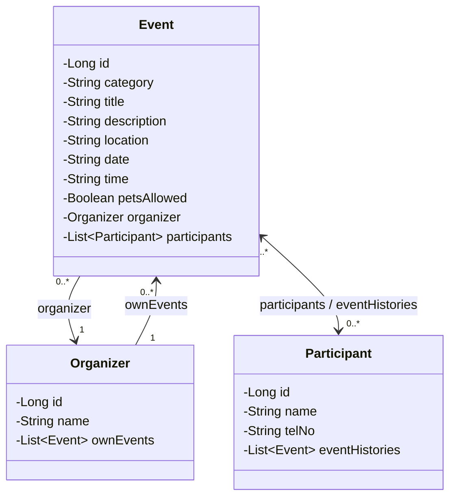

# Entity Class Diagram — Lab 8 (JPA Relationship)

## Relationship mapping

| Relationship | Owning side | Inverse side | Annotation |
|---|---|---|---|
| Organizer — Event | `Event.organizer` | `Organizer.ownEvents` | `@ManyToOne` / `@OneToMany(mappedBy = "organizer")` |
| Event — Participant | `Event.participants` | `Participant.eventHistories` | `@ManyToMany` / `@ManyToMany(mappedBy = "participants")` |

- **One Organizer owns many Events** (1 : N) — the foreign key `organizer_id` lives in the `event` table.
- **An Event has many Participants and a Participant joins many Events** (N : N) — Hibernate creates the join table `event_participants`.
